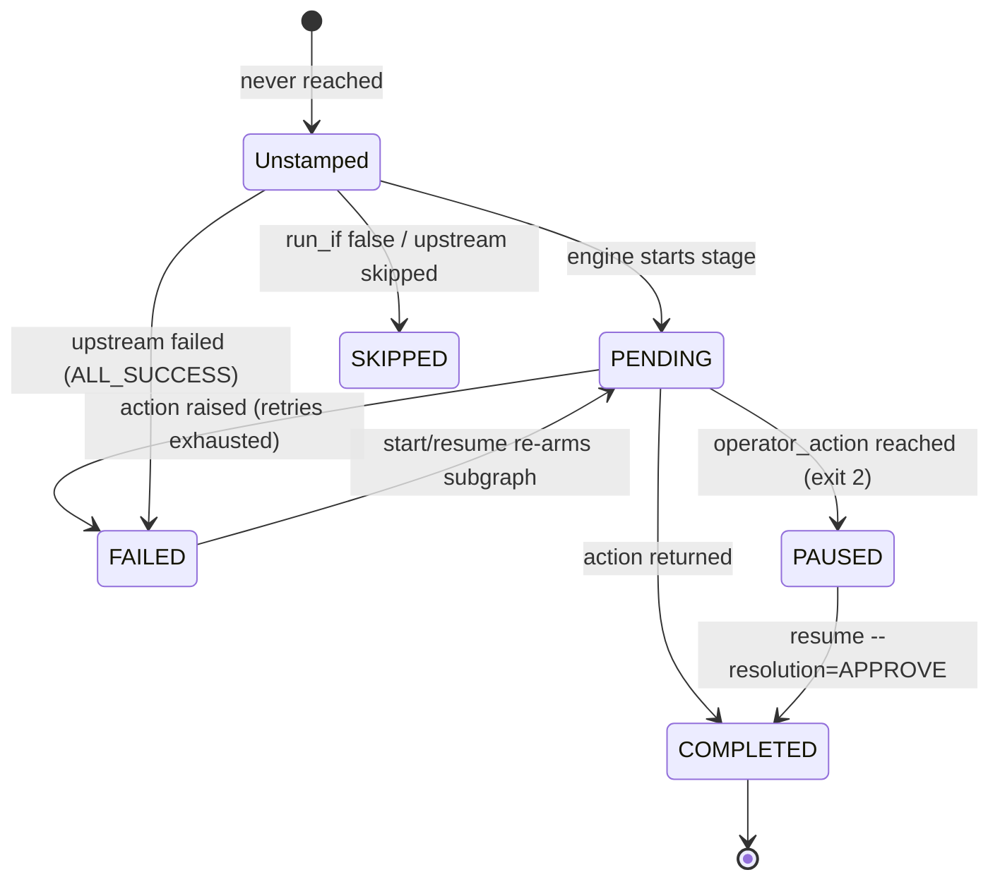

<!-- mdformat global-off -->

# Lightflow: Deterministic DAG Workflow Engine for AI Agents

Agent skills (`SKILL.md`) are typically written as prose checklists: run a
query, analyze the output, ask the user to review, render an artifact, ask
before sending. In practice, models drift past review steps, pull raw data into
the context window, and lose their place when a command fails or the session
compacts.

**Lightflow** replaces the prose checklist with an executable DAG
(`lightflow.yaml`). Deterministic steps are Python functions (`python_action`);
steps that require agent synthesis or human sign-off are explicit checkpoints
(`operator_action`). You interact with your agent in chat as usual while the
agent drives Lightflow through its CLI:



-   **Enforced ordering and checkpoints**: The engine runs `python_action`
    stages in topological order and halts at each `operator_action` (`exit 2`),
    returning control to the agent turn so it presents the checkpoint in chat
    and resumes only after a schema-validated response is supplied.
-   **Data stays out of model context**: Intermediate outputs pass between
    Python stages on disk (`passport.json`) rather than through tool `stdout`.
    The model sees one-line stage summaries and checkpoint prompts
    ([~250–1,700 tokens](./benchmarks/README.md) across the benchmarked
    workflows).
-   **Resumable without repeating side effects**: If a stage fails or a session
    is interrupted, `lightflow resume` continues from the stopped node and
    re-runs only the failed subgraph—completed upstream stages are not
    re-executed.
-   **Auditable state (`passport.json`)**: Every stage transition and every
    checkpoint payload is appended to a local JSON ledger with operator and
    session attribution (`user` / `agent:<session_id>`), inspectable via
    `lightflow status --verbose` or `lightflow visualize`.
-   **Reliable in scheduled agent automations**: When an agent runs unattended
    on a schedule (e.g., `/automation`, `claude -p`, or CI), nobody is watching
    the turn-by-turn chat to catch skipped steps. When an agent drives the run
    through a Lightflow manifest, the engine, not the agent, decides what runs
    next: stages execute in order, intermediate outputs are validated against
    JSON Schema, and the run halts only when a checkpoint needs human
    sign-off.

Lightflow is a pure-Python package (`PyYAML` and `jsonschema`, with stdlib
fallbacks from a checkout) with no server or daemon. Existing `SKILL.md`
procedures can be converted into manifests using the bundled
[`create_lightflows`](./skills/create_lightflows/SKILL.md) skill.

--------------------------------------------------------------------------------

## Key Features

-   **First-Class Agent Integrations**:
    -   **Agent Guides**: [`AGENTS.md`](./AGENTS.md) and
        [`CLAUDE.md`](./CLAUDE.md) for Claude Code, Gemini CLI, Codex, Cursor,
        and Antigravity. Agents drive Lightflow through the CLI; every command
        returns a compact, parseable summary and a process exit code.
    -   **Agent Skills & Streaming Notifications**: Includes
        [`skills/run_lightflows/SKILL.md`](./skills/run_lightflows/SKILL.md)
        (executing and resuming workflows),
        [`skills/create_lightflows/SKILL.md`](./skills/create_lightflows/SKILL.md)
        (authoring and converting `SKILL.md` files into workflows), and
        [`benchmarks/SKILL.md`](./benchmarks/SKILL.md), plus optional milestone
        notifications when running inside `agentapi`-compatible hosts.
-   **YAML & JSON Manifests**: Author workflows declaratively in **YAML
    (`.yaml`)** or **JSON (`.json`)**.
-   **Safe, CEL-like Expressions**: `run_if`, polling conditions, and dynamic
    gate instructions use a small subset of [CEL](https://cel.dev) syntax
    (`string()`, `int()`, `size()`, `has()`), evaluated by a pure-Python AST
    walker without native C/Go dependencies or unsafe `eval()`.
-   **Zero-Dependency Interactive Visualizer (`visualizer.html`)**: Generates a
    standalone, single-file HTML5 DAG canvas, execution trace log, and
    payload/manifest inspector with zero external CDN requests.

--------------------------------------------------------------------------------

## When to Use Lightflow (and When Not To)

Reach for Lightflow when **all** of these are true:

-   The task has several ordered steps with real side effects (modifying files,
    calling external APIs, publishing artifacts) that must not be repeated on a
    retry.
-   You want a human or an agent to inspect intermediate output and approve a
    checkpoint partway through (`operator_action`).
-   You want the run to be inspectable on disk (`passport.json`) and resumable
    across separate CLI invocations or compacted agent sessions.

Look elsewhere when:

-   **You need concurrent execution.** Execution is strictly single-threaded and
    evaluates stages sequentially in deterministic topological order.
-   **You need shared multi-user state.** State is a local file guarded by an
    advisory lock (`flock` / `msvcrt`), not a networked service.
-   **It is a single step.** Just call the function directly.

| Category | Representative Tools | Infrastructure | Execution Model | Where Lightflow Differs |
|:--------------|:-------------|:-------------|:----------|:-----------------|
| **Distributed Orchestrators** | Temporal, Prefect, Airflow | Server daemon + database | Distributed workers | Zero daemon or DB; state is a single atomic local JSON ledger (`passport.json`). |
| **Cyclic Agent Graphs** | LangGraph, Burr | In-process Python library | Cyclic state machines | Process-boundary suspension (`exit 2`) with auto-generated CLI `resume` commands and AST-restricted CEL-like conditions. |
| **Function / Task DAGs** | Hamilton, doit, Kedro | Local Python library | Single-run in-memory DAG | Built-in `operator_action` JSON Schema gates, `rollback_action` hooks, and append-only `Stamp` history. |

--------------------------------------------------------------------------------

## Installation

Install the `lightflow` CLI and Python package directly from GitHub:

```bash
# Latest on main
pip install "git+https://github.com/google/lightflow.git"

# Pinned to a specific release tag
pip install "git+https://github.com/google/lightflow.git@v0.6.6"
```

Or clone the repository to run the bundled `examples/`, `benchmarks/`, and
`create_lightflow` scaffolding workflow locally:

```bash
git clone https://github.com/google/lightflow.git
cd lightflow
pip install -e .
```

*(Or run directly from a checkout without installing dependencies using
`PYTHONPATH=. python3 -m lightflow ...`)*

> **Note (Pre-1.0):** Lightflow is pre-1.0 (`0.x`): the CLI, manifest fields,
> and `passport.json` format (`passport_version: 1`) may still change between
> minor versions. Pin a release tag
> (`pip install "git+https://github.com/google/lightflow.git@v0.6.6"`) if you
> depend on it.

### Where state lives

Each run's `passport.json` is written to
`~/.lightflow/lightflow_state_<log_id>/passport.json` by default. Set
`LIGHTFLOW_STATE_DIR=/some/dir` to relocate the `lightflow_state_<log_id>/`
directories (for example into a project-local or CI-scoped folder). Gate and
re-arm stamps attribute the action to `--operator` if passed, `LIGHTFLOW_OPERATOR`
if set, or `<user> (agent:<ANTIGRAVITY_CONVERSATION_ID>)` when invoked inside an
agent session so you can trace any approval back to its conversation transcript.

### Security model

`python_import` executes arbitrary Python by design — **treat manifests as
code** and review them like you would a script. For manifests authored by an
agent, set `LIGHTFLOW_ALLOWED_IMPORT_PREFIXES` to a comma-separated list of
module prefixes (e.g.
`LIGHTFLOW_ALLOWED_IMPORT_PREFIXES=my_pkg.actions,examples`) and the engine will
refuse to import any action outside those prefixes, while disabling
manifest-local `sys.path` injection and module eviction so an untrusted manifest
directory cannot shadow allowlisted packages.

--------------------------------------------------------------------------------

## 60-Second Runnable Quickstart

Run the workflow shown in the demo above. It uses only the standard library
(`sqlite3`) and writes to `/tmp`:

```bash
# 1. Dry-run simulation (validates DAG topology, CEL-like expressions & JSON Schemas)
lightflow dry_run --lightflow=examples/quarterly_revenue_brief/lightflow.yaml

# 2. Start execution (runs SQLite query + Python variance analysis, then pauses at 'draft_commentary' with exit code 2)
lightflow start --lightflow=examples/quarterly_revenue_brief/lightflow.yaml --log_id=q3

# 3. Supply the reviewed commentary (renders /tmp/q3_revenue_brief.md, then pauses at 'approve_send' with exit code 2)
lightflow resume --log_id=q3 \
  --stage=draft_commentary --resolution=APPROVE \
  --payload='{"approved": true, "commentary": "Q3 revenue grew +12.4% QoQ led by NA and APAC; EMEA trailed plan by 6.2% on Q4 renewal timing (closed Oct 4)."}'

# 4. Approve final delivery (dispatches report, writes receipt, and exits 0)
lightflow resume --log_id=q3 \
  --stage=approve_send --resolution=APPROVE

# 5. Generate a standalone interactive HTML5 DAG & timeline visualizer
lightflow visualize --log_id=q3 --output=/tmp/viz.html
```

`python3 -m lightflow ...` is equivalent to `lightflow ...` whenever the console
script is not on your `PATH`. On shells that strip inner double quotes (such as
Windows PowerShell 5.1) or when passing larger JSON objects, you can pass
payloads from a file or stdin via `--payload=@payload.json`, `--payload=@-`, or
`--payload_file=payload.json`.

--------------------------------------------------------------------------------

## Included Runnable Examples (`examples/`)

| # | Example | Pattern Demonstrated | External API / Mechanism |
| :-- | :-- | :-- | :-- |
| 1 | **[`examples/quarterly_revenue_brief/`](./examples/quarterly_revenue_brief/README.md)** | **SQL Query → Python Analysis → Commentary Checkpoint → Render → Send Checkpoint → Send**: 6-stage reporting workflow with two `operator_action` checkpoints (commentary review, send approval). | Python `sqlite3` (standard library) |
| 2 | **[`examples/hn_digest/`](./examples/hn_digest/README.md)** | **Live API → Human Editorial Gate → Idempotent Publish**: Fetches top stories, previews the #1 story in the gate prompt, and writes a Markdown digest. | Hacker News Firebase API (zero auth) |
| 3 | **[`examples/usgs_seismic_alert/`](./examples/usgs_seismic_alert/README.md)** | **Live Telemetry Triage**: Polls 24h M4.5+ global seismic events, pauses for severity classification (`INFO` / `ADVISORY` / `WATCH`), and emits a bulletin. | USGS GeoJSON Feed (zero auth) |
| 4 | **[`examples/pypi_upgrade_guard/`](./examples/pypi_upgrade_guard/README.md)** | **Live Audit → Approval Gate → Automatic `rollback_action`**: Compares pinned packages against live PyPI, applies upgrades, and automatically restores `.bak` if smoke tests fail. | PyPI JSON API (zero auth) |
| 5 | **[`examples/async_job_watcher/`](./examples/async_job_watcher/README.md)** | **Async Background Polling & `ALL_DONE` Cleanup**: Spawns a 10–20s background process, polls its status file via `polling_policy` until `READY`, and cleans up temp files. | Detached Worker + Local JSON Status File |
| 6 | **[`examples/create_lightflow/`](./examples/create_lightflow/README.md)** | **Staggered Agent Skill Delivery ("A Lightflow to Create Lightflows")**: 3 human/agent design & coding gates interleaved with deterministic AST, `unittest`, and `dry_run` verification stages. | Python `ast` + `unittest` + `LightflowEngine` |
| 7 | **[`examples/tenant_gitops_onboarding/`](./examples/tenant_gitops_onboarding/README.md)** | **22-Stage Multi-Branch Kubernetes, Cloud IAM & GitOps Onboarding**: 4-phase orchestration with 3 branching patterns (role-based early handoff, 3-way IAM status fan-out + `ALL_DONE` join, parallel S3/Vault + compliance-tier KMS diamond), 2 human gates, 2 GitOps PR merge loops, and ArgoCD sync polling. | Local Mocked GitOps / Cloud IAM / SCIM / KMS / ArgoCD Sandbox |

--------------------------------------------------------------------------------

## Authoring Your Own Workflow

Already have the procedure as a `SKILL.md`? See
[Starting From an Existing `SKILL.md`](./skills/create_lightflows/SKILL.md#1b-starting-from-an-existing-skillmd)
for the step-by-step mapping (mechanical steps become `python_action`s,
judgment and decisions stay as gates), then continue below.

### 1. Write Python Actions (`my_pkg/actions.py`)

Each `python_action` is a regular Python function that receives a copy of the
current `payload` dictionary (plus any `static_kwargs` from the manifest) and
returns either `(payload_delta_dict, message_str)` or just `payload_delta_dict`
(which Lightflow merges into `payload` and records under
`payload.outputs.<stage_name>`):

```python
from typing import Any

def fetch_rows(
    payload: dict[str, Any], limit: int = 500, dry_run: bool = False
) -> tuple[dict[str, Any], str]:
    if dry_run or payload.get("dry_run"):
        return {"count": 0, "summary": "0 rows (dry run)"}, "[DRY RUN] Skipped fetch"
    return {"count": limit, "summary": f"{limit} rows"}, f"Fetched {limit} rows"

def publish_report(payload: dict[str, Any]) -> tuple[dict[str, Any], str]:
    summary = payload["outputs"]["fetch"]["summary"]
    return {"published": True}, f"Published report ({summary})"
```

### 2. Define the Workflow Manifest (`lightflow.yaml`)

```yaml
name: daily_revenue_report
description: Fetch rows, wait for human approval, and publish report.

actions:
  - id: fetch_rows
    python_import: my_pkg.actions.fetch_rows
  - id: publish_report
    python_import: my_pkg.actions.publish_report

stages:
  - name: fetch
    description: Fetch daily rows
    python_action:
      action_id: fetch_rows
      static_kwargs:
        limit: 500
    retry_policy:
      max_attempts: 3

  - name: approve
    description: Human review gate
    run_after:
      - fetch
    operator_action:
      instructions: "'Ready to publish: ' + payload.outputs.fetch.summary"
      json_schema:
        type: object
        required: [approved]
        properties:
          approved:
            type: boolean

  - name: publish
    description: Publish verified report
    run_after:
      - approve
    run_if: "payload.outputs.approve.approved == true"
    python_action:
      action_id: publish_report
```

### 3. Stage & Expression Reference

| Stage Field | Purpose |
|:----------------|:-------------------------------------------------------|
| `run_after` | Upstream stage names that must finish before this stage evaluates. |
| `run_if` | CEL-like expression evaluated against `payload`; stage is stamped `SKIPPED` if `false`. With top-level `strict_expressions: true`, selecting an absent key fails the stage instead of yielding `null`, naming the key and the closest match (guard optional keys with `has()`). |
| `trigger_rule` | `ALL_SUCCESS` (default), `NONE_FAILED` (runs once upstreams finished and none failed — the join after complementary `run_if` branches), or `ALL_DONE` (runs even after an upstream failure; cleanup stages). |
| `timeout_seconds` | Bounds how long the engine waits for each attempt (`0`–`86400`s; `0` disables the bound). A timeout does not cancel the action: it keeps running in a background thread, so pass explicit timeouts to the action's own I/O clients. A retry is started only if the timed-out attempt finishes during the backoff, and `rollback_action` waits up to one more `timeout_seconds` for it before running; otherwise the stage fails with an explicit "not retried" / "rollback skipped" note. |
| `retry_policy` | Opt-in retry (`max_attempts`, `initial_backoff_seconds`, `backoff_multiplier`) with ±10% jitter for exceptions and timeouts. |
| `polling_policy` | Polls `poll_tick_action` (mutually exclusive with `python_action`) until `condition` evaluates to `true` (`interval_seconds`, `timeout_seconds`, `max_attempts`); each tick's dict is merged into `payload.outputs.<stage>` before `condition` runs, and tick messages are persisted to `passport.json`. |
| `rollback_action` | Compensating `python_action` invoked automatically after a stage exhausts its retries; its output delta is merged into `payload`. |
| `secret_keys` (top-level) | Payload keys, matched at any depth (so `outputs.<stage>.<key>` is covered), whose values are shown as `<redacted>` in output made to be read or shared: `start`/`resume` console output, `status` (including `--verbose`), `dry_run`, and the visualizer HTML. String values held under those keys are also replaced in other payload strings, stamp messages, and gate instructions when rendered; opaque values derived from a secret (e.g. a hash or a server-minted token) should have their own key listed in `secret_keys`. `passport.json` keeps the real values because later stages need them on resume; the state directory is created mode `0700`. |

-   **Stage Output Namespacing & Collision Detection**: Stage outputs land both
    under `payload.outputs.<stage>` and at the top level of `payload` (last
    writer wins; `outputs` is a reserved top-level key). The engine warns `⚠️
    [stage] overwrote top-level payload.<key>` when a later stage changes a key
    an earlier one set *and* some expression reads `payload.<key>` (two stages
    sharing a reusable action is otherwise silent); prefer
    `payload.outputs.<stage>.<key>` in expressions and check `status --verbose`
    for per-key provenance.
-   **Actionable `dry_run` Diagnostics**: `dry_run` ends with a `Summary:` line
    (including `❌ N would fail` for expressions that would error at runtime), a
    ready-to-paste `💡 --payload` hint when a branch reads unseeded keys, and
    the `stage→action` pairs that lack `dry_run` support.
-   **Run Discovery & Remembered Manifests**: `lightflow list` enumerates
    saved runs with the manifest each
    was started from. Runs record their manifest in `passport.json`, so
    `status`, `resume`, `visualize`, and `cleanup` need only `--log_id=<id>`; if
    the manifest moves, pass `--lightflow=<new path>` once and it is
    re-recorded.
-   **Safe Re-Arming & Force-Start Summary**: `start --force` prints what it
    discards (completed stages, paused gate, history) before wiping. An
    `ALL_DONE` stage that ran because an upstream failed or a gate was rejected
    is automatically re-armed (`↻ cleanup re-armed …`) when that cause is
    re-armed or the gate re-opened, so it runs again at the real end of the run.
-   **Milestone Push Notifications (`agentapi`)**: Agent push notifications via
    `agentapi` are disabled by default (`LIGHTFLOW_NOTIFY=off`) so synchronous
    CLI runs do not double-notify a caller that already reads stdout;
    set `LIGHTFLOW_NOTIFY=milestones` (for detached/background runs) to push
    only gate suspensions, failures, rejections, rollbacks, and the final
    outcome, or `LIGHTFLOW_NOTIFY=all` for every stage transition.

**Expression Evaluator (`run_if`, `polling_policy.condition`,
`operator_action.instructions`)**:

-   **Operators**: `&&`, `||`, `!`, `==`, `!=`, `<`, `<=`, `>`, `>=`, `+`, `-`,
    `*`, `/`
-   **Built-ins**: `size(x)` / `len(x)`, `has(x.field)`, `string(x)`, `int(x)`,
    `double(x)`, `bool(x)` (all null-safe: `string(null) == ""`, `int(null) ==
    0`)
-   **String & Collection Methods**: `contains()`, `startsWith()`, `endsWith()`,
    `replace()`, `split()`, `strip()`, `lower()`, `upper()`
-   **Per-Stage Output Namespacing**: Every stage's delta is merged into
    `payload` and also recorded under `payload.outputs.<stage_name>` to prevent
    key collisions across stages.

--------------------------------------------------------------------------------

## Execution & Failure Semantics

### Stage Lifecycle (`passport.json`)

Each stage carries zero or more **stamps** in the passport. A stage's current
state is its *most recent* stamp; earlier stamps are retained as an audit log.



When a stage fails:

1.  The failing stage is stamped `FAILED` with its traceback, and its
    `rollback_action` runs if configured.
2.  Downstream dependents under `ALL_SUCCESS` are stamped `FAILED` as collateral
    (`Upstream dependency failed`), while independent parallel branches in a
    diamond continue to completion and `ALL_DONE` cleanup stages still execute.
3.  Running `lightflow resume` appends a fresh `PENDING` stamp to the failed
    stage and its collateral dependents—re-running only the broken subgraph
    while preserving completed upstream work and keeping the earlier `FAILED`
    stamp in history.

### CLI Exit Codes

| Exit Code | Meaning | Typical Next Step |
|:--------|:-----------------------------|:------------------------------|
| `0` | Workflow completed (or was already completed). | Done. |
| `1` | Stage failure, compile error, or a payload that fails the gate schema. | Inspect `lightflow status`, fix the cause, and run `lightflow resume`. |
| `2` | Suspended at an `operator_action` gate awaiting human/agent input. | Run `lightflow resume --stage=<name> --resolution=APPROVE --payload='{...}'`. A paused gate parks only its own dependents: independent branches keep running first, several gates can be open at once, and the briefing (and `status`) lists each with its resume command. A decided failure in the same run exits `1` instead and names the open gates. |
| `3` | No saved state for the log ID (`status`, `resume`). | Check the log ID (`lightflow list`), or `start`. |
| `4` | Another process holds the run's lock (`start`, `resume`, `cleanup`, `status`). | Wait, then check `status` again. |
| `5` | Waiting: a `polling_policy` stage yielded (timeout / max attempts) before its condition was met. Nothing is broken; downstream stages are not touched. | Once the external condition holds, run `lightflow resume`. |

`lightflow status` exits with the code of the run it inspects (`0` completed,
`1` failed, rejected, or interrupted, `2` paused, `5` waiting), so a script or agent can poll
it and branch exactly as it would on `start` or `resume`. It prints one line per
stage plus any paused gate's Instructions, Payload Schema, and resume command;
`--verbose` adds the Passport payload, full stamp log, and Mermaid diagram.

--------------------------------------------------------------------------------

## Agent Ecosystem Setup

### For Antigravity (`agy`) & Skill-Based Agents

This repository ships with [`plugin.json`](./plugin.json) and two progressive-disclosure skills ([`skills/run_lightflows/SKILL.md`](./skills/run_lightflows/SKILL.md) and [`skills/create_lightflows/SKILL.md`](./skills/create_lightflows/SKILL.md)):

```bash
# Option A: Mount the entire repository as a single plugin
ln -s "$(pwd)" ~/.gemini/config/plugins/lightflow

# Option B: Mount only the on-demand skills
ln -s "$(pwd)/skills/run_lightflows" ~/.gemini/config/skills/run_lightflows
ln -s "$(pwd)/skills/create_lightflows" ~/.gemini/config/skills/create_lightflows
```

### For Claude Code, Gemini CLI, Codex & Cursor

Copy [`AGENTS.md`](./AGENTS.md) or [`CLAUDE.md`](./CLAUDE.md) into your
repository root (or install
[`skills/run_lightflows/SKILL.md`](./skills/run_lightflows/SKILL.md) and
[`skills/create_lightflows/SKILL.md`](./skills/create_lightflows/SKILL.md)) to
instruct your agent on executing, resuming, and authoring Lightflow workflows.
The `create_lightflow` scaffolding meta-workflow those files reference lives in
this repository under `examples/create_lightflow/`; run it from a clone of
`github.com/google/lightflow`, or pass the absolute path to that directory in
your clone (`--lightflow=/path/to/lightflow/examples/create_lightflow`).

--------------------------------------------------------------------------------

## License & Disclaimer

Licensed under the [Apache 2.0 License](./LICENSE).

This is not an officially supported Google product. Eligibility for the
[Google Open Source Software Vulnerability Rewards Program](https://bughunters.google.com/open-source-security)
is determined by the
[Google Open Source Software Vulnerability Reward Program Rules](https://bughunters.google.com/about/rules/open-source/google-open-source-software-vulnerability-reward-program-rules).
