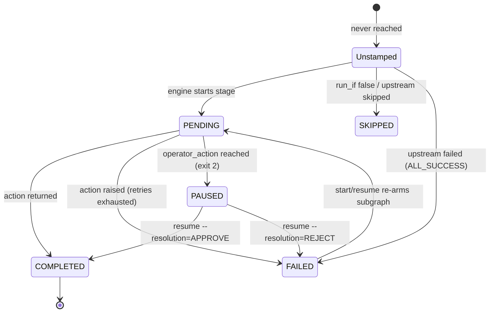

<!-- mdformat global-off -->

# Lightflow Technical Reference

This document covers the manifest schema, CEL-lite expression language, `passport.json` state lifecycle, CLI exit codes, and security controls for [Lightflow](../README.md).

---

## 1. Manifest Schema (`lightflow.yaml` / `lightflow.json`)

### Top-Level Fields

| Field | Type | Required | Description |
| :--- | :--- | :---: | :--- |
| `name` | `string` | Yes | Workflow identifier recorded in `passport.json`. |
| `description` | `string` | No | Human-readable summary of the workflow. |
| `actions` | `list[ActionDefinition]` | No | Registry mapping `id` to `python_import` (`pkg.module.func` or manifest-relative `actions.func`). |
| `stages` | `list[Stage]` | Yes | Ordered or DAG-linked stages to execute. |
| `secret_keys` | `list[string]` | No | Payload keys (matched at any depth, including `outputs.<stage>.<key>`) whose values and string occurrences are scrubbed as `<redacted>` in console output, `status`, `dry_run`, and `visualizer.html`. |
| `strict_expressions` | `bool` | No | When `true`, selecting a missing key in a `run_if`, `condition`, or `instructions` expression fails the stage (naming the closest key match) instead of returning `null`. Guard optional fields with `has()`. |
| `runner_target` | `string` | No | Optional custom CLI command prefix echoed in printed `Resume with:` hints. |

### Stage Fields

Each stage defines **exactly one** execution mechanism (`python_action`, `operator_action`, or `polling_policy`):

| Stage Field | Purpose |
| :--- | :--- |
| `name` | Unique stage identifier (must be a valid Python identifier and not a keyword). |
| `description` | Short human-readable label displayed in `status`, `dry_run`, and `visualizer.html`. |
| `run_after` | List of upstream stage names that must finish before this stage evaluates. |
| `run_if` | CEL-like boolean expression evaluated against `payload`; stage is stamped `SKIPPED` if `false`. |
| `trigger_rule` | `ALL_SUCCESS` (default: runs when all upstreams succeeded), `NONE_FAILED` (runs once upstreams finished and none failed — used for join stages after complementary `run_if` branches), or `ALL_DONE` (runs even after an upstream failure or rejection — used for cleanup stages). |
| `python_action` | Calls a registered Python function (`action_id`, optional `static_kwargs` dict). |
| `operator_action` | Suspends the process with `exit 2` (`instructions` CEL-like string expression, optional `json_schema` object). |
| `polling_policy` | Repeatedly runs `poll_tick_action` until `condition` evaluates to `true` (`interval_seconds`, `timeout_seconds`, optional `max_attempts`; stage-level `python_action` is also accepted as a backwards-compatible fallback for `poll_tick_action`). Each tick's output dict is merged into `payload` and `payload.outputs.<stage>` before `condition` is checked, and tick progress messages are saved to `passport.json`. |
| `retry_policy` | Opt-in retry for `python_action` exceptions and timeouts (`max_attempts`, `initial_backoff_seconds`, `backoff_multiplier`) with ±10% random jitter. Syntax, import, and signature errors fail immediately without retry. |
| `rollback_action` | Compensating `python_action` invoked automatically after a stage exhausts its retries or when an `operator_action` gate is rejected (`--resolution=REJECT`). Its returned dict delta is merged into `payload`. |
| `timeout_seconds` | Bounds how long the engine waits per attempt (`0`–`86400`s; `0` disables the bound). See [Timeouts, Retries & Rollbacks](#timeouts-retries--rollbacks) below. |

### Stage Output Namespacing & Collision Detection

When stage `fetch` returns `({"count": 500}, "Fetched 500 rows")`, Lightflow writes the delta to two places:
1. **Per-stage namespace (`payload.outputs.fetch.count`)** — immutable snapshot of that stage's output, immune to later stages returning the same key name.
2. **Top-level `payload.count`** — flat convenience view (last writer wins; `outputs` is a reserved top-level key).

If a later stage overwrites a top-level key set by an earlier stage *and* any expression in the manifest reads `payload.<key>` directly, the engine prints a warning (`⚠️ [stage] overwrote top-level payload.<key>`) and advises switching to `payload.outputs.<stage>.<key>`. Run `lightflow status --log_id=<id> --verbose` to inspect per-key provenance.

### Timeouts, Retries & Rollbacks

Python threads cannot be forcibly killed from user space. When `timeout_seconds` expires on a `python_action` or polling tick:
- The engine stops waiting and raises `StageTimeoutError`, while the timed-out worker thread continues in the background until its underlying I/O call returns (always pass explicit timeouts to HTTP/DB clients inside actions).
- If `retry_policy` has remaining attempts, the engine waits for the backoff interval and checks whether the timed-out thread finished during the backoff. If it is still running, the engine **does not start a concurrent retry** (preventing overlapping side effects) and fails with an explicit `"not retried"` note.
- Before invoking `rollback_action`, the engine waits up to one additional `timeout_seconds` window for any in-flight worker thread to exit; if the worker is still alive, rollback is skipped with an explicit warning in the stamp message.
- A polling tick is additionally bounded by what is left of `polling_policy.timeout_seconds`, so a hung tick cannot outlive the polling budget even when the stage sets no `timeout_seconds`. Running out of polling budget *during* a tick is treated like running out *between* ticks: the stage yields (exit `5`, no rollback) and `resume` polls again. Only a `stage.timeout_seconds` expiry is a hard failure with rollback.

### Secret Redaction (`secret_keys`)

Listing key names in top-level `secret_keys` (e.g., `secret_keys: [api_token, db_password]`) protects sensitive values across all human- and agent-facing surfaces:
- **Key matching at any depth**: Both `payload.api_token` and `payload.outputs.<stage>.api_token` are replaced with `<redacted>`.
- **Substring scrubbing**: Non-empty string values stored under a secret key are also scrubbed if interpolated into other payload strings, stamp messages, console progress lines, gate `Instructions`, `status` (including `--verbose`), `dry_run`, or `visualizer.html`.
- **Opaque derived values**: If an action derives a new opaque secret (such as a hash or a server-minted session token) and returns it under a different key name, include that key name in `secret_keys` as well.
- **On-disk persistence**: `passport.json` retains the unredacted values so downstream stages can read them on `resume`. The state directory is created with mode `0700`.

---

## 2. CEL-Lite Expression Reference

`run_if`, `polling_policy.condition`, and `operator_action.instructions` use a safe, pure-Python AST evaluator supporting a subset of [Common Expression Language (CEL)](https://cel.dev) syntax (no `eval()` or native C/Go dependencies).

- **Logical & Comparison Operators**: `&&` (or `and`), `||` (or `or`), `!` (or `not`), `==`, `!=`, `<`, `<=`, `>`, `>=`, `in`, `not in`, ternary `cond ? a : b`
- **Arithmetic & String Concatenation**: `+` (auto-coerces primitives when concatenated onto a string), `-`, `*`, `/`, `%` (numeric modulo only)
- **Null-Safe Built-ins**:
  - `has(payload.a.b)` — `true` if the field path exists and its value is non-null
  - `size(x)` / `len(x)` — length of a string, list, or dict (`0` for `null`)
  - `string(x)` — converts to string (`""` for `null`, `"true"` / `"false"` for booleans)
  - `int(x)`, `double(x)`, `bool(x)` — type conversions (`0` / `0.0` / `false` for `null`)
- **String & Collection Methods**: `contains()`, `startsWith()`, `endsWith()`, `replace(old, new)`, `split(sep)`, `strip()`, `lower()`, `upper()`, `get(key, default)`
- **Compile-Time Validation**: `compile()` parses every expression in the manifest and verifies that any `payload.outputs.<stage>` reference names an existing stage that is an upstream dependency in `run_after`.
- **Memory Caps**: Sequence repetition (`*`) is capped at `10,000` elements and string/list evaluation results are capped at `1,000,000` characters/items to prevent accidental OOM DoS.

---

## 3. Execution Lifecycle & Failure Semantics

### Where State Lives

- Default path: `~/.lightflow/lightflow_state_<log_id>/passport.json` (override the root directory with `LIGHTFLOW_STATE_DIR=/path/to/dir`).
- Each run directory is guarded by an OS advisory lock (`fcntl.flock` on POSIX, `msvcrt.locking` on Windows) and updated via atomic temp-file-and-rename writes.
- Every gate decision and subgraph re-arm records operator attribution (`--operator`, `LIGHTFLOW_OPERATOR`, or `<user> (agent:<ANTIGRAVITY_CONVERSATION_ID>)`).

### Stage Stamp State Machine

Each stage carries an append-only list of **stamps** in `passport.json`. A stage's effective state is its *most recent* stamp; earlier stamps remain as an audit trail.



### Failure, Collateral & Re-Arming Rules

1. **Failure & Rollback**: When a stage exhausts its retries, it is stamped `FAILED` with its traceback, and its `rollback_action` executes if configured.
2. **Collateral vs. Independent Branches**: Downstream dependents under `ALL_SUCCESS` are stamped `FAILED` with `reason = UPSTREAM_FAILED` (reported as `⛔ blocked` by `status`), while independent parallel branches in a diamond DAG continue to completion and `ALL_DONE` cleanup stages still run.
3. **Selective Subgraph Re-Arming**: Running `lightflow resume --log_id=<id>` appends a fresh `PENDING` stamp to failed stages and their collateral dependents—re-running only the broken subgraph while preserving completed upstream stages. Pass `--stage=<name> --cascade=false` to re-arm a single failed stage without re-arming its downstream dependents.
4. **Automatic `ALL_DONE` Cleanup Re-Arming**: If an `ALL_DONE` cleanup stage already ran because an upstream stage failed or a gate was rejected, re-arming that failure or re-opening the rejected gate automatically re-arms the `ALL_DONE` stage (`↻ cleanup re-armed …`) so cleanup runs again at the true end of the workflow.
5. **Interrupted In-Flight Stages (At-Least-Once Semantics)**: If a process is killed while a stage is actively executing (`PENDING`), `status` reports it as `interrupted` (`INCOMPLETE`) and `resume` prints a warning (`⚠️ Stage '<name>' was interrupted mid-run and will be executed again; make sure it is idempotent.`) before re-executing it.

---

## 4. CLI Commands, Exit Codes & Notifications

### CLI Commands

```bash
# Preview DAG topology, expressions, schemas, and dry_run-capable actions
lightflow dry_run --lightflow=<dir_or_manifest> [--payload='{...}']

# Start a run (accepts inline JSON, --payload=@file.json, --payload=@-, or --payload_file=file.json)
lightflow start --lightflow=<dir_or_manifest> --log_id=<id> [--payload='{...}'] [--force]

# Resolve a paused operator_action gate (--lightflow is remembered from start;
# --resolution and --comment require --stage and are refused without it)
lightflow resume --log_id=<id> --stage=<gate> --resolution=APPROVE [--payload='{...}']
lightflow resume --log_id=<id> --stage=<gate> --resolution=REJECT [--comment="..."]

# Retry failed stages without repeating completed upstream stages
lightflow resume --log_id=<id> [--payload='{...}']

# Inspect run status (exits with the run's own status code; --verbose adds payload, provenance, stamps, Mermaid)
lightflow status --log_id=<id> [--verbose]

# List all saved runs under $LIGHTFLOW_STATE_DIR
lightflow list [--state_dir=<dir>]

# Generate a zero-CDN standalone HTML5 DAG & timeline inspector (--out is an alias for --output)
lightflow visualize --log_id=<id> [--output=/tmp/viz.html]

# Delete saved state for a run (leaves external workflow artifacts untouched)
lightflow cleanup --log_id=<id>
```

### Process Exit Codes

Both `start`/`resume` and `status` exit with the code corresponding to the run's state:

| Exit Code | Meaning | Next Step |
| :---: | :--- | :--- |
| `0` | Workflow completed (or was already completed). | Done. |
| `1` | Stage failure, rejected gate (`🛑`), interrupted stage, compile error, or invalid gate payload. | Inspect `lightflow status`, fix the cause, and run `lightflow resume`. |
| `2` | Suspended at one or more `operator_action` gates awaiting human/agent input. | Follow the printed `Instructions` and run the printed `lightflow resume --stage=<name> --resolution=APPROVE ...` command. |
| `3` | No saved state found for `--log_id` (`status`, `resume`). | Check `lightflow list` or start a new run with `lightflow start`. |
| `4` | Another process currently holds the run's advisory lock. | Wait for the active process to finish, then check `lightflow status`. |
| `5` | Waiting: a `polling_policy` stage yielded (timeout / `max_attempts`) before its condition was met. | Once the external condition holds, run `lightflow resume --log_id=<id>`. |

### Actionable `dry_run` Diagnostics

If a Python action function accepts `dry_run: bool = False` in its signature, `lightflow dry_run` invokes it with `dry_run=True` so downstream expressions and gate instructions can be previewed with simulated data. At the end of a preview, `dry_run` prints:
- A `Summary:` line (`N simulated, M static, K would fail`).
- A copy-pasteable `💡 --payload='{...}'` seed hint when `run_if` branches read top-level keys that were not supplied.
- Any `stage→action` pairs whose Python functions do not yet accept `dry_run: bool = False`.

### Milestone Push Notifications (`LIGHTFLOW_NOTIFY`)

When running inside an `agentapi`-compatible host (`ANTIGRAVITY_CONVERSATION_ID` set and `agentapi` on `PATH`):
- `LIGHTFLOW_NOTIFY=off` *(default)*: Disables background push notifications so synchronous CLI calls do not double-notify an agent that already reads `stdout`.
- `LIGHTFLOW_NOTIFY=milestones`: Pushes notifications only on gate suspensions, stage failures, gate rejections, rollbacks, and final workflow completion (ideal for detached/background runs).
- `LIGHTFLOW_NOTIFY=all`: Pushes a notification on every stage entry and completion.

### Import Allowlisting (`LIGHTFLOW_ALLOWED_IMPORT_PREFIXES`)

`python_import` executes arbitrary Python by design — treat manifests as code. When running manifests authored by an untrusted source or agent, set `LIGHTFLOW_ALLOWED_IMPORT_PREFIXES=my_pkg.actions,examples` (or pass `allowed_import_prefixes` to `LightflowEngine`). The executor will reject any `python_import` outside those module prefixes and disable manifest-local `sys.path` injection and module cache eviction so files in the manifest directory cannot shadow allowlisted packages.
